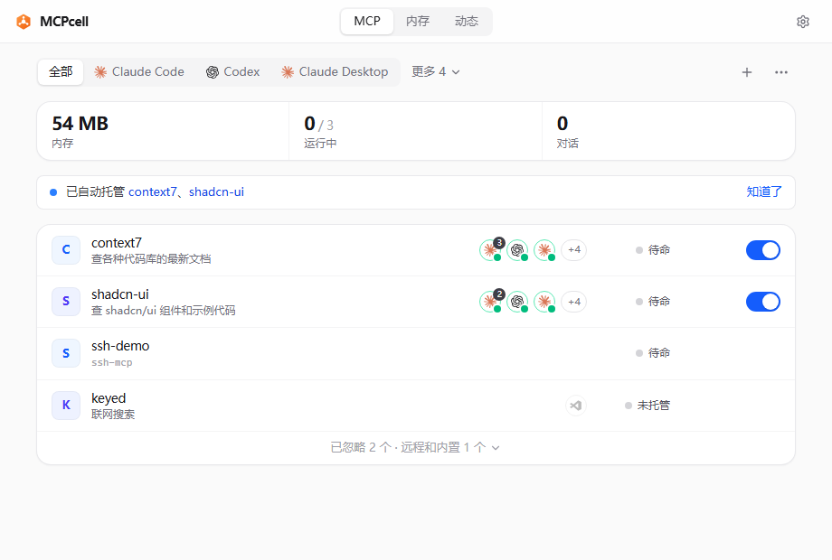
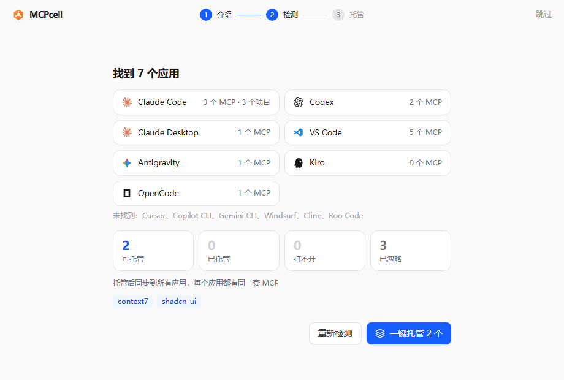
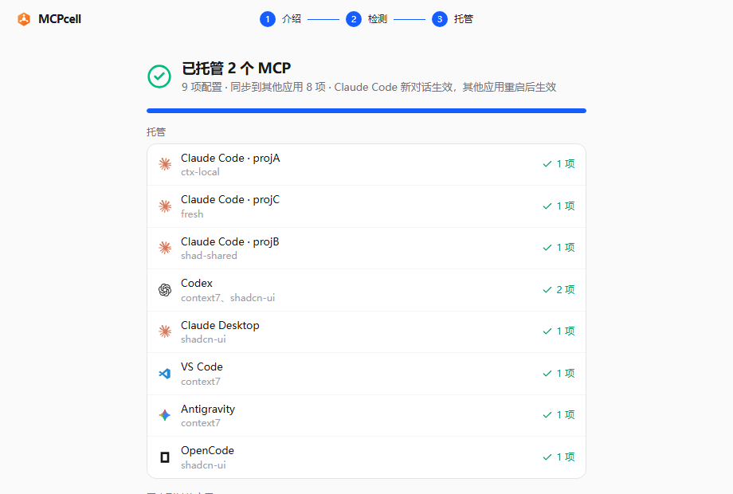
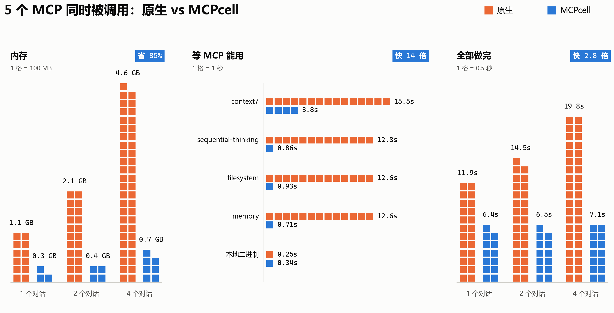

<div align="center">


# MCPcell

### Claude Code、Codex、Cursor、Gemini CLI 等 13 个 AI 应用的本机 MCP 运行时

**本机所有 AI 应用共用一套 MCP：每个 MCP 全机只开一份，用到才启动，闲了就关。**

[](https://github.com/luohui1/MCP-cell/releases)
[](https://github.com/luohui1/MCP-cell/releases)
[](https://go.dev/)
[](https://www.rust-lang.org/)
[](https://github.com/luohui1/MCP-cell/releases/latest)

**[让 AI 帮你装](#让-ai-帮你装) · [下载安装](#下载安装) · [快速开始](#快速开始) · [功能特性](#功能特性) · [原理](#原理) · [实测](#实测) · [常见问题](#常见问题)**

</div>

## 为什么需要 MCPcell

MCP 服务是一个个 stdio 进程。Claude Code、Codex、Cursor 每开一个对话，就把配置里的 MCP 全部再起一遍：同一个 context7，开 8 个对话就是 8 份。一台开发机实测，8 个对话共 71 个 MCP 进程、约 **2.9 GB** 内存，而大部分 MCP 一次都没被调用；npx 启动的 MCP 冷启动十几秒，常常撞上应用的 30 秒连接超时。

**MCPcell** 在本机常驻一个后台，把这些 MCP 收拢到一处管理：

- **全机一份** — 同一个 MCP，所有应用、所有对话共用一个进程；凭据不同或有对话状态的自动分开
- **用到才启动** — 工具列表缓存在本地，对话连上即可用；第一次调用工具才启动 MCP，空闲后自动关闭
- **一键托管 13 个应用** — 自动找出各应用配置里的 MCP，一键交给 MCPcell；之后新加的自动托管
- **所有应用同一套 MCP** — 一个应用里加的 MCP 同步到其他应用，不用每个应用各配一遍
- **随时还原** — 改配置前整文件备份，一键全部还原，各应用配置逐字节恢复
- **轻量** — 后台是 Go 单文件，转发程序用 Rust 写，约 1 MB；不需要 Node、Python 或 Docker

## 界面预览

<table>
<tr>
<td align="center" width="50%"><br>首页：哪些应用在用、内存、托管开关</td>
<td align="center" width="50%"><br>一键检测：找到的应用和各自的 MCP</td>
</tr>
<tr>
<td align="center"><br>一键托管：逐个应用托管、同步</td>
<td align="center"><br>实测：5 个 MCP 同时被调用</td>
</tr>
</table>

## 让 AI 帮你装

命令行版本，不装托盘图标和窗口。把下面这段发给 Claude Code、Codex 等 AI 助手：

```text
请按 https://raw.githubusercontent.com/luohui1/MCP-cell/main/docs/agent-setup.md 的步骤，在这台电脑上安装 MCPcell，并托管本机 AI 应用的 MCP。
```

也可以自己运行一行命令：下载最新版本、安装到 `~/.mcpcell/bin`、开启开机自启、一键托管。

Windows（PowerShell）：

```powershell
irm https://raw.githubusercontent.com/luohui1/MCP-cell/main/scripts/install.ps1 | iex
```

macOS、Linux：

```sh
curl -fsSL https://raw.githubusercontent.com/luohui1/MCP-cell/main/scripts/install.sh | sh
```

设 `MCPCELL_NO_TAKEOVER=1` 只安装不托管，`MCPCELL_NO_AUTOSTART=1` 不开机自启。撤销：`mcpcell restore --all`。

## 下载安装

### 系统要求

| 系统 | 状态 | 说明 |
|---|---|---|
| Windows 10 / 11（x64） | 正式 | 托盘图标、独立窗口、开机自启 |
| macOS（Apple 芯片 / Intel） | 预览 | 管理页在浏览器里打开，没有托盘 |
| Linux（x64） | 预览 | 同 macOS |

到 [Releases](https://github.com/luohui1/MCP-cell/releases/latest) 下载对应系统的包：`mcpcell-windows-amd64`、`mcpcell-darwin-arm64`、`mcpcell-darwin-amd64`、`mcpcell-linux-amd64`。

### Windows

```powershell
tar -xzf mcpcell-windows-amd64.tar.gz
cd mcpcell-windows-amd64
.\mcpcell install                    # 装到 ~/.mcpcell/bin 并启动后台
~\.mcpcell\bin\mcpcell open          # 打开窗口
```

### macOS / Linux（预览）

```sh
tar -xzf mcpcell-darwin-arm64.tar.gz && cd mcpcell-darwin-arm64
xattr -dr com.apple.quarantine .     # 只在 macOS：包没有签名，去掉下载隔离
./mcpcell install
~/.mcpcell/bin/mcpcell open          # 在浏览器里打开管理页
```

和 Windows 的区别：没有托盘和独立窗口；开机自启用 LaunchAgent（macOS）或 XDG 自启（Linux），下次登录生效；内存按进程组的常驻内存统计；不能给 MCP 设内存上限。

也可以从源码编译，见 [开发](#开发)。

## 快速开始

1. **打开**：`mcpcell open`。第一次打开会出现使用引导
2. **一键检测**：列出找到的应用、各自的 MCP，以及哪些可以托管
3. **一键托管**：逐个应用托管，再把 MCP 同步到其他应用
4. **重开 Agent 的对话**：Claude Code 新对话即生效，其他应用重启后生效

不想用了：首页右上角菜单里的「全部还原」，或者 `mcpcell restore --all`。

## 功能特性

### 托管与还原

- 一键托管：先试启动每个 MCP，起不来的保持原样并说明原因，不托管
- 自动托管：之后在任何应用里新加的 MCP 自动交给 MCPcell；你还原过的不再自动托管
- 自动忽略：程序已经不在、或从来没启动成功过的 MCP 收进「已忽略」，不会一直报错
- 还原：单个还原或全部还原，改前整文件备份，你改过的条目不覆盖

### 所有应用同一套 MCP

- 一个应用里经 MCPcell 用着的 MCP，加到还没有它的应用里（设置里可以关）
- 从某个应用里还原或删掉的，不会再加回去
- 远程 MCP、只在某个 Claude Code 项目里用的、应用里有同名别的 MCP 的，不同步

### 运行

- 已知无状态的 MCP 全机一份，其余每个对话一份；共享空闲 3 分钟关闭，按对话的在对话结束时关闭
- npx 启动的包缓存到本地并锁定版本，直接用 node 运行；context7 从 4 个进程约 235 MB 降到 2 个进程约 84 MB
- Windows 上每个 MCP 的进程树放进 Job Object，后台怎么退出都会一起清理；可按服务设内存上限

### 管理页

- 首页：所有 MCP 一行一个，用途、哪些应用在用、内存或状态、托管开关
- 内存：当前占用、1 小时 / 24 小时曲线、每个 MCP 的内存
- 动态：托管、还原、启动失败等记录，按天分组

### 支持的应用

| 应用 | 配置文件 |
|---|---|
| Claude Code | `~/.claude.json`（用户级、项目级），项目里的 `.mcp.json` |
| Codex | `~/.codex/config.toml` |
| Cursor | `~/.cursor/mcp.json` |
| Claude Desktop | `<应用数据>/Claude/claude_desktop_config.json` |
| VS Code | `<应用数据>/Code/User/mcp.json` |
| Copilot CLI | `~/.copilot/mcp-config.json` |
| Gemini CLI | `~/.gemini/settings.json` |
| Antigravity | `~/.gemini/antigravity/mcp_config.json` |
| Windsurf | `~/.codeium/windsurf/mcp_config.json` |
| Kiro | `~/.kiro/settings/mcp.json` |
| Cline、Roo Code | VS Code 扩展存储里的 MCP 设置 |
| OpenCode | `~/.config/opencode/opencode.json` 或 `opencode.jsonc` |

`<应用数据>`：Windows 是 `%APPDATA%`，macOS 是 `~/Library/Application Support`，Linux 是 `~/.config`。项目里的 `.mcp.json` 是团队共享文件，MCPcell 不改它，而是在本机加一条同名的私有配置覆盖它。

## 原理

MCPcell 由两部分组成：常驻后台（Go）和转发程序 `mcpcell-run`（Rust，约 1 MB）。

```
Agent 会话 A ── mcpcell-run ─┐
Agent 会话 B ── mcpcell-run ─┼── 127.0.0.1 ──► MCPcell 后台 ──► 实例池：context7 ×1、memory ×1 …
Agent 会话 C ── mcpcell-run ─┘
```

- **stdio 包装接入**：托管时在 Agent 配置的原命令前加上 `mcpcell-run`，原命令、参数、环境变量原样保留。Agent 仍按 stdio 启动 MCP，`mcpcell-run` 经本机回环把 JSON-RPC 报文转给后台，后台按命令和参数匹配到对应服务。条目名和工具全名不变，Agent 已有的审批规则继续生效
- **能力目录缓存 + 按需启动**：服务首次启动后，`initialize` 结果和 `tools/list`、`prompts/list`、`resources/list` 持久化为能力目录。会话握手和列表请求直接由目录应答，第一次 `tools/call` 才拉起上游进程
- **多路复用**：一个上游进程服务多个会话时，后台把每个请求的 JSON-RPC id 和 progressToken 改写为实例内唯一值，响应和进度通知按映射还原到原会话，取消请求只作用于本会话。除这几个归属字段，报文原样透传
- **隔离模式**：shared（全机一份）和 per-session（每个会话一份）。实例按命令、参数、环境变量的指纹区分，凭据不同自然分开；未知服务默认按会话。共享服务一旦发出服务端请求（roots、sampling、elicitation），或握手结果因客户端而异，自动降为按会话

### 设计理念

- **对客户端透明**：只改写路由必需的归属字段，不改工具名、不伪造能力、不重放调用；上游中途退出时如实返回"结果未知"，由 Agent 决定是否重试
- **可降级**：后台不在时由 `mcpcell-run` 拉起；后台或服务起不来时回退为直接运行原命令，最坏情况等同于没装
- **可还原**：改配置前整文件备份，只改所选条目，用户改过的条目不覆盖；还原逐字节恢复
- **隔离优先于复用**：宁可多开一份实例，也不让会话之间串数据
- **以测量为准**：内存统一报私有提交（任务管理器默认的工作集会低估闲置进程），基准脚本随仓库提供

完整设计见 [架构](docs/architecture.md)，各阶段测量见 [里程碑](docs/roadmap.md)。

## 实测

同一台机器上 1、2、4 个对话同时调用 5 个 MCP（context7、memory、sequential-thinking、filesystem 和一个本地二进制 MCP），每轮从冷启动开始，原生和 MCPcell 各 3 轮，1806 次调用全部成功：


| 对话数 | 内存 | 全部调用做完 |
|---|---|---|
| 1 | 1.16 GB → 0.33 GB | 11.9 秒 → 6.4 秒 |
| 2 | 2.16 GB → 0.45 GB | 14.5 秒 → 6.5 秒 |
| 4 | 4.66 GB → 0.69 GB | 19.8 秒 → 7.1 秒 |

npx 启动的 MCP 从打开对话到第一个结果：12.6–15.5 秒 → 0.7–3.8 秒。代价是 MCP 已在运行时，每次调用多 0.4–0.7 毫秒。复现：`scripts/mcpbench.py --concurrent`。

## 常用命令

| 命令 | 作用 |
|---|---|
| `mcpcell open` | 打开窗口（需要时先启动后台） |
| `mcpcell status` | 各个 MCP 开着几份、连着的对话、占多少内存 |
| `mcpcell takeover` | 一键托管：先列出要改的内容，确认后执行（`-y` 直接执行），再同步到其他应用（`--sync off` 关掉） |
| `mcpcell restore --all` | 全部还原 |
| `mcpcell stop` | 停止后台 |

`mcpcell help --all` 列出全部命令，每个命令都可以加 `-h`。

## 配置（可选）

窗口里能改的都不用碰配置文件。需要时在 `~/.mcpcell/config.json` 里给服务加设置：

```json
{
  "services": {
    "context7": { "command": "npx", "args": ["-y", "@upstash/context7-mcp"], "idleTimeout": "5m", "memoryLimit": "1GB" }
  }
}
```

`idleTimeout` 空闲多久关掉（`"0"` 不关）；`memoryLimit` 整棵进程树的内存上限；`flatten: false` 保留 npx 启动；`catalog: "off"` 不缓存工具列表；顶层 `interface: "cli"` 不显示托盘图标。

## 常见问题

<details>
<summary><b>会不会改坏我的配置？</b></summary>

改之前整文件备份到 `~/.mcpcell/backups`，只改所选的条目，你改过的条目不覆盖。还原时逐字节恢复。
</details>

<details>
<summary><b>MCPcell 没开或者挂了，Agent 还能用 MCP 吗？</b></summary>

能。`mcpcell-run` 发现后台不在会先把它拉起来；拉不起来，或者某个 MCP 在 MCPcell 里起不来，就直接运行原命令，和没装一样。
</details>

<details>
<summary><b>哪些 MCP 会共用一个进程？</b></summary>

已知无状态的（如 context7、文档查询类）全机一份；浏览器调试这类有对话状态的每个对话一份；不认识的默认每个对话一份，仍然享受按需启动和空闲关闭。凭据（环境变量）不同的绝不共用。
</details>

<details>
<summary><b>远程（HTTP）MCP 会托管吗？</b></summary>

不会。远程 MCP 本来就没有本地进程，原样保留。
</details>

<details>
<summary><b>显示的内存为什么比任务管理器大？</b></summary>

任务管理器默认显示工作集，Windows 会压缩闲置进程的工作集，但它们的提交内存仍然算进系统提交上限。MCPcell 统一报私有提交，更接近真实开销。
</details>

<details>
<summary><b>怎么卸载？</b></summary>

依次运行 `mcpcell restore --all`（还原各应用配置）、`mcpcell autostart off`（关掉开机自启）、`mcpcell stop`（停止后台），再删除 `~/.mcpcell`。
</details>

## 开发

```sh
go vet ./... && go test ./...
cd web && npm install && npm run build && cd ..        # 改了管理页才需要（产物已提交）
go build -ldflags "-s -w" -o bin/mcpcell.exe ./cmd/mcpcell
go build -ldflags "-s -w -H windowsgui" -o bin/mcpcelld.exe ./cmd/mcpcell
go build -ldflags "-s -w -H windowsgui" -o bin/mcpcell-tray.exe ./cmd/mcpcell-tray
cd shim && cargo build --release && cd .. && cp shim/target/release/mcpcell-run.exe bin/
bin/mcpcell.exe install                                # 装到 ~/.mcpcell/bin
```

每次推送都会在 GitHub Actions 上于 Windows、macOS、Linux 跑全部测试并打包，`v*` 标签发布到 Releases。

## 友情链接

- [LINUX DO](https://linux.do) — 新的理想型社区
